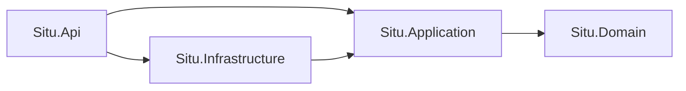

# Arquitectura

El backend es una arquitectura limpia organizada por vertical slices. No usa MediatR. Un caso de uso es un `IHandler<TRequest, TResponse>` que el endpoint inyecta directo.

## Capas



| Proyecto | Responsabilidad |
| --- | --- |
| `Situ.Domain` | Entidades, agregados, reglas y eventos. No referencia otros proyectos ni paquetes NuGet. |
| `Situ.Application` | Un slice por caso de uso, `Result` / `Error`, validación y puertos (`IApplicationDbContext`, `IClock`, `IPasswordHasher`, `ITokenService`, `IEmailSender`, `ICurrentUser`). Solo referencia Domain. |
| `Situ.Infrastructure` | EF Core, Postgres/PostGIS, interceptores y el adaptador de `IApplicationDbContext`. No referencia `Situ.Api`. |
| `Situ.Api` | HTTP: autenticación, CORS, OpenAPI, salud y endpoints. Traduce `Result` a `IResult`. No usa tipos de Domain salvo enums e identificadores. |

`apps/backend/tests/Situ.Architecture.Tests` fija esas dependencias con NetArchTest. `pnpm api:test` también corre `Situ.Domain.Tests`.

Los clientes (`apps/web`, `apps/landing`, `apps/support`, `apps/mobile`) hablan con la API a través de `packages/shared`. No reimplementan reglas de edad, anonimato, planes ni bloqueo.

## Vertical slice

Cada caso de uso vive en su carpeta, con request, response y handler:

```text
apps/backend/src/Situ.Application/Features/<Módulo>/<Caso>/
  Request.cs
  Response.cs
  Handler.cs
apps/backend/src/Situ.Api/Endpoints/<Módulo>/<Caso>Endpoint.cs
```

`AddApplication` recorre el ensamblado, registra cada clase que implementa `IHandler<TRequest, TResponse>` y, si la respuesta es un `Result`, la envuelve en `ValidationHandlerDecorator`. El decorador corre los `IValidator<TRequest>` de FluentValidation y, si fallan, devuelve `ErrorType.Validation` sin entrar al handler.

`MapSituEndpoints` recorre `Situ.Api`, encuentra los tipos que implementan `IEndpoint` y llama a su `Map` estático sobre el grupo `/api/v1`.

Un fallo esperado es un `Result` con `Error`. `DomainException` queda para invariantes rotas. El endpoint no decide el código HTTP a mano: llama a `ToHttpResult()`.

| `ErrorType` | HTTP |
| --- | --- |
| `Validation` | 400 |
| `Unauthorized` | 401 |
| `Forbidden` | 403 |
| `NotFound` | 404 |
| `Conflict` | 409 |
| `Locked` | 423 |
| `Failure` | 500 |

El cuerpo es un ProblemDetails con la extensión `code`. Los enums JSON salen como string.

La hora de aplicación entra por `IClock` (`TimeProvider`). Los métodos de dominio reciben un `DateTimeOffset`; no leen el reloj ellos mismos. Al guardar, `AuditSaveChangesInterceptor` marca `CreatedAt` / `UpdatedAt` y `DomainEventSaveChangesInterceptor` despacha los eventos del agregado.

## Ejemplo: listar países

Slice de lectura que ya está en el código. `Country` es el agregado en `Situ.Domain/Geography/Country.cs` (código ISO, edad mínima, unidad de distancia, si el país está habilitado).

El handler, en `Features/Geography/ListCountries/Handler.cs`, filtra `IsEnabled`, ordena por nombre y proyecta un `CountryItem`. No expone la entidad.

`IApplicationDbContext` es el puerto. `AppDbContext` en Infrastructure lo implementa con Npgsql y NetTopologySuite. `GeoPoint` se persiste como `geography(Point, 4326)`.

`Endpoints/Geography/ListCountriesEndpoint.cs` registra `GET /geography/countries` como anónimo, inyecta `IHandler<ListCountriesRequest, Result<ListCountriesResponse>>` y devuelve `result.ToHttpResult()`. Con el grupo de la API, la ruta queda en `GET /api/v1/geography/countries`.

Para un caso nuevo el camino es el mismo: regla en el agregado si cambia estado, carpeta `Features/<Módulo>/<Caso>` con el handler, y un `IEndpoint` que llame a `ToHttpResult()`.
