# Modelo de dominio

Catálogo leído de las clases de `apps/backend/src/Situ.Domain`. Cada entidad hereda de `Entity` (identificador `Guid` v7). `AuditableEntity` añade `CreatedAt` y `UpdatedAt`. `AggregateRoot` es la frontera de consistencia y acumula eventos de dominio.

`Email` y `UserName` son value objects. `GeoPoint` es una coordenada WGS84; la distancia se calcula con haversine. `LockoutPolicy`, `MinorProtectionPolicy` y `AnonymousIdentity` son reglas, no tablas.

Los vínculos del diagrama son propiedades `Guid` que nombran otra entidad. Donde el id es opcional, la relación también lo es. Comentarios, reacciones, denuncias, acciones de moderación, solicitudes de retiro, retenciones legales, el registro de acceso a una identidad anónima y las notificaciones apuntan a contenido con `ContentTargetType` + `TargetId` (reporte, comentario, transmisión, usuario). Ese puntero polimórfico no se dibuja como una llave foránea única.

## Geografía

| Entidad | Base | Rol |
| --- | --- | --- |
| `Country` | AggregateRoot | País: ISO, locale, moneda, zona horaria, unidad de distancia (`Kilometers` o `Miles`), edad mínima de registro y si está habilitado. |
| `Region` | AuditableEntity | División del país. `CountryId`. |
| `City` | AuditableEntity | Ciudad, con centro `GeoPoint`. `RegionId` y `CountryId`. |

## Identidad

| Entidad | Base | Rol |
| --- | --- | --- |
| `User` | AggregateRoot | Cuenta: correo, nombre de usuario, hash de contraseña, fecha de nacimiento, país, región y ciudad de interés, estado, confirmación de correo, autorización del acudiente, bloqueo, suspensión y borrado. |
| `UserDevice` | AuditableEntity | Teléfono o navegador con sesión. El identificador lo genera la app. Guarda el token push. La web cuenta como un dispositivo. |
| `RefreshToken` | AuditableEntity | Refresh token rotativo, atado a un dispositivo. Se guarda el hash. `ReplacedByTokenId` encadena la rotación. |
| `SecurityToken` | AuditableEntity | Token de un solo uso para confirmar el correo o recuperar la contraseña. Se guarda el hash. |
| `LoginAttempt` | Entity | Intento de ingreso, exitoso o no. Conserva el correo escrito aunque no exista la cuenta. |

`LockoutPolicy` fija el valor por defecto: 5 intentos y 15 minutos. Los valores efectivos salen de la configuración del sistema.

## Tutela

| Entidad | Base | Rol |
| --- | --- | --- |
| `GuardianConsent` | AggregateRoot | Autorización del representante de un menor de 18 (Ley 1581 de 2012, Decreto 1377 de 2013). El menor indica el correo; el acudiente abre el enlace, completa datos, verifica el correo y autoriza. La ventana de respuesta es de 7 días. |

`MinorProtectionPolicy` no es una entidad. La edad adulta es 18. Bajo 16, el vivo además exige autorización específica del acudiente. La edad mínima para registrarse está en `Country.MinimumAge`, no en esta política. Un menor no tiene perfil público, solo transmite a amigos y siempre en anónimo, no ve categorías de adultos y no recibe publicidad personalizada.

## Legal

| Entidad | Base | Rol |
| --- | --- | --- |
| `LegalDocument` | AuditableEntity | Enlace al texto legal (términos, privacidad, perfil público, ubicación, anuncios, aviso al acudiente) por país e idioma, con versión. `CountryId` nulo aplica a todos los países. |
| `ConsentRecord` | Entity | Prueba de aceptación: usuario, tipo, versión, método, fecha y origen. Revocar deja el registro y llena `RevokedAt`. |

## Perfiles

| Entidad | Base | Rol |
| --- | --- | --- |
| `UserProfile` | AggregateRoot | Cara pública y privacidad. El perfil nace privado. `ShowRealtimeLocation` aplica al perfil público. `ShareLocationWithFriends` es independiente y nace apagado. |
| `UserLocation` | Entity | Última posición enviada por el móvil. Esta fila guarda el punto durable para cercanos y avisos a 1 km. |
| `PrivacyZone` | AuditableEntity | Zona (casa, trabajo) donde la ubicación en tiempo real no se muestra. |
| `LocationShareRecipient` | AuditableEntity | Amigo que recibe la ubicación cuando el modo es «amigos seleccionados». |
| `AvatarGalleryItem` | AuditableEntity | Ícono de avatar predefinido, administrado desde el panel. |

## Social

| Entidad | Base | Rol |
| --- | --- | --- |
| `Friendship` | AggregateRoot | Solicitud entre dos usuarios. Aceptada, es la red de avisos y de ubicación. Solo quien recibe acepta o rechaza; solo quien invita cancela. |
| `FriendInvitation` | AuditableEntity | Invitación por correo a quien puede no tener cuenta. Si se registra con el enlace, nace una solicitud de amistad. Vigencia por defecto: 30 días. |
| `UserBlock` | AuditableEntity | Un usuario bloquea a otro: dejan de verse contenido y ubicación. |

## Anonimato

No hay entidad. `AnonymousIdentity` arma la etiqueta pública «Situero anónimo» y, dentro de una misma conversación, «Situero anónimo N». El índice no se reutiliza entre publicaciones. La antigüedad pública es mes y año. El autor real sigue guardado para moderación, reputación y ley.

## Reportes

| Entidad | Base | Rol |
| --- | --- | --- |
| `ReportCategory` | AggregateRoot | Tipo de reporte administrable (accidente, hurto, retén, basura): TTL, peso de importancia, media exigida, íconos y flag de solo adultos. `ParentCategoryId` permite jerarquía. |
| `ReportCategoryTranslation` | AuditableEntity | Nombre y descripción de la categoría en un locale. |
| `ReportCategoryOverride` | AuditableEntity | Enciende, apaga o cambia el TTL de una categoría para un país o una ciudad. |
| `Report` | AggregateRoot | Lo que alguien reporta en un punto. Vive en el mapa hasta `ExpiresAt`. Se confirma, se reacciona y se comenta. `SourceLiveStreamId` lo liga a una grabación de un vivo. |
| `ReportMedia` | AuditableEntity | Foto o video. En base solo está la clave del objeto. |
| `ReportConfirmation` | AuditableEntity | Un voto por usuario: «sigue ahí» o «ya no está». Votar de nuevo reemplaza el voto. «Sigue ahí» alarga la vida del reporte. |
| `Comment` | AuditableEntity | Comentario de un reporte o un vivo. Puede ser anónimo, con `AnonymousIndex` dentro de esa conversación. `ParentCommentId` es la respuesta. |
| `Reaction` | AuditableEntity | Una reacción por usuario y objetivo. |

## Transmisión

| Entidad | Base | Rol |
| --- | --- | --- |
| `LiveStream` | AggregateRoot | Video en vivo iniciado en el móvil. Un menor solo transmite a amigos y siempre en anónimo; el anonimato difumina rostros y modifica la voz. `ReportId` publica la grabación como reporte. |
| `LiveViewer` | AuditableEntity | Quien mira o miró una transmisión. |

La grabación pública dura 60 días por defecto y la copia interna de moderación, 7. Esos plazos se pueden cambiar en la configuración del sistema.

## Notificaciones

| Entidad | Base | Rol |
| --- | --- | --- |
| `NotificationSettings` | AuditableEntity | Preferencias de la persona: radio cercano, horas de silencio, push, correo y avisos de amigos o noticias. |
| `NotificationPreference` | AuditableEntity | Interruptor de un tipo de aviso en un canal. |
| `UserInterestCity` | AuditableEntity | Ciudad extra que la persona sigue, además de la suya. |
| `UserCategoryInterest` | AuditableEntity | Categoría que quiere o que silenció. |
| `Notification` | AuditableEntity | Ítem de la bandeja. |
| `NotificationDelivery` | AuditableEntity | Un intento de entrega por canal (push a un dispositivo, correo). |

## Noticias

| Entidad | Base | Rol |
| --- | --- | --- |
| `ImportanceScoringConfig` | AuditableEntity | Parámetros del algoritmo de noticia importante, editables por país. El puntaje combina peso de categoría, confirmaciones, comentarios, reacciones, reputación y bono de media, y decae con la edad del reporte. |
| `NewsItem` | AuditableEntity | Reporte promovido a noticia importante de una ciudad. |
| `UserReputation` | AuditableEntity | Reputación interna de quien reporta, de 0 a 10 (empieza en 5). Los reportes anónimos también cuentan para el autor real. |

## Monetización

| Entidad | Base | Rol |
| --- | --- | --- |
| `SubscriptionPlan` | AggregateRoot | Plan Free, Basic, Pro o Advanced. Los límites viven en datos; `null` significa ilimitado. |
| `PlanPrice` | AuditableEntity | Precio por periodo, moneda y, si aplica, país. El monto va en la unidad menor. |
| `Subscription` | AggregateRoot | Suscripción de una persona a un plan de pago. Sin suscripción, está en Free. |
| `Payment` | AuditableEntity | Cobro. No se guarda la tarjeta: solo la referencia del proveedor. Puede colgar de una suscripción o de un pin patrocinado. |
| `SponsoredPin` | AggregateRoot | Pin de negocio en el mapa, marcado como patrocinado. |

## Organizaciones

| Entidad | Base | Rol |
| --- | --- | --- |
| `Organization` | AggregateRoot | Cuenta verificable de un medio, una autoridad o un negocio. |
| `OrganizationMember` | AuditableEntity | Membresía con rol `Owner`, `Admin` o `Editor`. |
| `AlertRule` | AuditableEntity | Regla para avisar a la organización de reportes por categoría, ciudad o radio alrededor de un punto. |

## Moderación

| Entidad | Base | Rol |
| --- | --- | --- |
| `Complaint` | AggregateRoot | Denuncia de una persona sobre contenido o sobre otra persona. Las que involucran menores tienen prioridad. |
| `ModerationAction` | AuditableEntity | Registro inmutable de lo que hizo el staff y por qué. |
| `AnonymousIdentityAccessLog` | AuditableEntity | Cada vez que el staff revela al autor de una publicación anónima, con justificación. |
| `TakedownRequest` | AggregateRoot | Retiro pedido desde fuera (quien aparece en el contenido, habeas data, autoridad). El plazo de respuesta por defecto es 15 días. |

## Administración

| Entidad | Base | Rol |
| --- | --- | --- |
| `StaffRole` | AuditableEntity | Rol del panel (los permisos son datos). |
| `StaffPermission` | AuditableEntity | Permiso de un rol, como código (`categories.manage`). `StaffPermissionCodes` lista los códigos conocidos. |
| `StaffAssignment` | AuditableEntity | Un usuario del producto con un rol de staff. |
| `SystemSetting` | AuditableEntity | Configuración clave/valor editable sin publicar la app. `SystemSettingKeys` nombra las claves. |
| `AuditLog` | Entity | Bitácora de solo adición: actor, acción, entidad e IP. |

## Retención

| Entidad | Base | Rol |
| --- | --- | --- |
| `RetentionPolicy` | AuditableEntity | Cuántos días se conserva cada tipo de dato antes del borrado. |
| `DataExportRequest` | AggregateRoot | Copia descargable de los datos de la persona (acceso y portabilidad). |
| `AccountDeletionRequest` | AggregateRoot | Derecho de supresión, con un plazo para arrepentirse. |
| `LegalHold` | AggregateRoot | Congela el borrado de un objetivo por una exigencia legal. `PlacedByStaffId`. |

## Diagrama

```mermaid
erDiagram
  Country ||--o{ Region : CountryId
  Country ||--o{ City : CountryId
  Region ||--o{ City : RegionId

  Country ||--o{ User : CountryId
  Region ||--o{ User : RegionId
  City ||--o{ User : CityId
  User ||--o{ UserDevice : UserId
  User ||--o{ RefreshToken : UserId
  UserDevice ||--o{ RefreshToken : UserDeviceId
  RefreshToken }o--o| RefreshToken : ReplacedByTokenId
  User ||--o{ SecurityToken : UserId
  User |o--o{ LoginAttempt : UserId

  User ||--o{ GuardianConsent : MinorUserId

  User ||--o{ ConsentRecord : UserId
  Country |o--o{ LegalDocument : CountryId
  Country |o--o{ ConsentRecord : CountryId

  User ||--o{ UserProfile : UserId
  AvatarGalleryItem |o--o{ UserProfile : AvatarGalleryItemId
  User ||--o{ UserLocation : UserId
  City |o--o{ UserLocation : CityId
  User ||--o{ PrivacyZone : UserId
  User ||--o{ LocationShareRecipient : UserId
  User ||--o{ LocationShareRecipient : FriendUserId

  User ||--o{ Friendship : RequesterId
  User ||--o{ Friendship : AddresseeId
  User ||--o{ FriendInvitation : InviterId
  User |o--o{ FriendInvitation : AcceptedByUserId
  User ||--o{ UserBlock : BlockerId
  User ||--o{ UserBlock : BlockedUserId

  ReportCategory |o--o{ ReportCategory : ParentCategoryId
  ReportCategory ||--o{ ReportCategoryTranslation : CategoryId
  ReportCategory ||--o{ ReportCategoryOverride : CategoryId
  Country |o--o{ ReportCategoryOverride : CountryId
  City |o--o{ ReportCategoryOverride : CityId
  User ||--o{ Report : AuthorId
  ReportCategory ||--o{ Report : CategoryId
  City |o--o{ Report : CityId
  LiveStream |o--o{ Report : SourceLiveStreamId
  Report ||--o{ ReportMedia : ReportId
  Report ||--o{ ReportConfirmation : ReportId
  User ||--o{ ReportConfirmation : UserId
  User ||--o{ Comment : AuthorId
  Comment |o--o{ Comment : ParentCommentId
  User ||--o{ Reaction : UserId

  User ||--o{ LiveStream : StreamerId
  ReportCategory ||--o{ LiveStream : CategoryId
  City |o--o{ LiveStream : CityId
  Report |o--o{ LiveStream : ReportId
  LiveStream ||--o{ LiveViewer : LiveStreamId
  User ||--o{ LiveViewer : UserId

  User ||--o{ NotificationSettings : UserId
  User ||--o{ NotificationPreference : UserId
  User ||--o{ UserInterestCity : UserId
  City ||--o{ UserInterestCity : CityId
  User ||--o{ UserCategoryInterest : UserId
  ReportCategory ||--o{ UserCategoryInterest : CategoryId
  User ||--o{ Notification : RecipientId
  Notification ||--o{ NotificationDelivery : NotificationId
  UserDevice |o--o{ NotificationDelivery : DeviceId

  Report ||--o{ NewsItem : ReportId
  City ||--o{ NewsItem : CityId
  ReportCategory ||--o{ NewsItem : CategoryId
  Country |o--o{ ImportanceScoringConfig : CountryId
  User ||--o{ UserReputation : UserId

  SubscriptionPlan ||--o{ PlanPrice : PlanId
  Country |o--o{ PlanPrice : CountryId
  User ||--o{ Subscription : UserId
  SubscriptionPlan ||--o{ Subscription : PlanId
  PlanPrice ||--o{ Subscription : PriceId
  User ||--o{ Payment : UserId
  Subscription |o--o{ Payment : SubscriptionId
  SponsoredPin |o--o{ Payment : SponsoredPinId
  User ||--o{ SponsoredPin : OwnerUserId
  Organization |o--o{ SponsoredPin : OrganizationId
  City |o--o{ SponsoredPin : CityId

  City |o--o{ Organization : CityId
  Organization ||--o{ OrganizationMember : OrganizationId
  User ||--o{ OrganizationMember : UserId
  Organization ||--o{ AlertRule : OrganizationId
  ReportCategory |o--o{ AlertRule : CategoryId
  City |o--o{ AlertRule : CityId

  User ||--o{ Complaint : ReporterId
  User |o--o{ Complaint : ResolvedByStaffId
  User ||--o{ ModerationAction : StaffId
  Complaint |o--o{ ModerationAction : ComplaintId
  User ||--o{ AnonymousIdentityAccessLog : StaffId
  Complaint |o--o{ AnonymousIdentityAccessLog : ComplaintId
  User |o--o{ TakedownRequest : HandledByStaffId

  StaffRole ||--o{ StaffPermission : RoleId
  User ||--o{ StaffAssignment : UserId
  StaffRole ||--o{ StaffAssignment : RoleId
  User |o--o{ StaffAssignment : GrantedByUserId
  User |o--o{ AuditLog : ActorUserId

  User ||--o{ AccountDeletionRequest : UserId
  User ||--o{ DataExportRequest : UserId
  User ||--o{ LegalHold : PlacedByStaffId

  SystemSetting {
    guid Id PK
    string Key
    string Value
  }
  RetentionPolicy {
    guid Id PK
    string Kind
    int RetainDays
  }
```

`SystemSetting` y `RetentionPolicy` no tienen llave foránea: la primera guarda una clave y un valor; la segunda clasifica el dato con `RetentionDataKind`. En el diagrama, `|o` marca el lado opcional (`Guid?` en la clase) y `||` el lado obligatorio.
